# Threading & the GIL

The GIL explains *why* Python threading behaves the way it does; this
page covers that, then the problems threaded programs run into and how
to fix them, with a hands-on task to see a race condition happen rather
than just read about one. See
[Choosing a Concurrency Model](choosing-a-concurrency-model.md) for when
threading is the right tool at all, and
[Multiprocessing in Practice](multiprocessing-in-practice.md) for the
CPU-bound case threading can't help with.

!!! example "Real-world analogy: one chef, one kitchen"
    - One kitchen, one chef, one knife — only one task can be actively
      "chopping" (executing Python) at any instant. That's the GIL.
    - A pot of water boiling is I/O — the chef doesn't stand there
      staring at it. They put the knife down (release the GIL) and
      chop something else while it boils, then pick the knife back up.
      This is why more threads help when there's a lot of waiting.
    - Pure chopping with no waiting is CPU-bound work. Hiring more
      chefs doesn't help here — there's still only one knife, so extra
      chefs just wait their turn. This is why more threads *don't*
      help CPU-bound work.
    - To genuinely chop faster you need separate kitchens, each with
      its own chef and own knife, working at the same instant — that's
      multiprocessing. The cost: kitchens can't hand ingredients
      directly anymore, they have to shout things between rooms
      (serializing data between processes).
    - **Concurrency** is one chef juggling multiple pots — switching
      attention over time, no second chef required. **Parallelism** is
      multiple chefs actually chopping at the same literal instant —
      in Python, that only happens with separate kitchens (processes).

The diagram below is that same story as a timeline — watch who's
holding the knife (the GIL) at each moment:

```mermaid
%%{init: {'theme': 'default', 'themeVariables': {'fontSize': '20px'}, 'gantt': {'barHeight': 46, 'barGap': 12, 'fontSize': 20, 'sectionFontSize': 20, 'leftPadding': 140, 'topPadding': 60, 'gridLineStartPadding': 30}}}%%
gantt
    title One GIL, Two Threads: Who's Holding the Knife
    dateFormat X
    axisFormat %s
    section Thread A
    Chopping (has the GIL)     :a1, 0, 2
    Boiling water (I/O wait)   :a2, 2, 3
    Chopping (has the GIL)     :a3, 5, 2
    section Thread B
    Waiting for the knife      :b1, 0, 2
    Chopping (has the GIL)     :b2, 2, 3
    Boiling water (I/O wait)   :b3, 5, 2
```



- **0-2:** Thread A has the knife (GIL) and chops. Thread B just waits
  — the knife is taken.
- **2-5:** Thread A starts boiling water (I/O) and puts the knife down.
  Thread B picks it up and chops *during that exact window* — this
  overlap is the entire reason threading helps I/O-bound code.
- **5-7:** Thread A's water is ready, it takes the knife back and
  resumes chopping. Thread B now goes to boil its own water.
- Notice there's never a moment where *both* bars show "chopping" at
  once — only one thread ever holds the GIL. The speedup comes purely
  from overlapping the *waiting*, not from two threads computing
  simultaneously.

## The GIL

**"Explain the GIL. Then explain why threads still help I/O-bound code
despite it."**

**Answer:**

- The GIL is a single mutex in CPython that prevents more than one
  thread from executing Python bytecode at a time.
- Threads still help I/O-bound work because a thread **releases** the
  GIL while blocked on I/O (network call, file read, DB query) —
  another thread runs during that wait. A regular (sequential) loop
  can't do this: if each iteration waits on something, the total time
  is the *sum* of every wait, one after another. A threaded loop lets
  multiple iterations be in flight at once, so the total time becomes
  closer to the *longest single wait*, not the sum of all of them.
- CPU-bound work gets no benefit from threads at all, since only one
  thread can be *executing* Python at any instant no matter how many
  exist — for that case, reach for `multiprocessing`/
  `ProcessPoolExecutor` instead, where each process gets its own GIL
  and actually runs on a separate core (see
  [Multiprocessing in Practice](multiprocessing-in-practice.md)).

**Concrete example — fetching 20 URLs:**

- Sequential: 20 requests × 0.5s each ≈ 10 seconds total.
- Threaded (`ThreadPoolExecutor(max_workers=5)`, as in
  [Worker Pools & Backpressure](worker-pools-and-backpressure.md#task-a-bounded-worker-pool-using-threadpoolexecutor)):
  5 requests waiting concurrently at a time ≈ 20/5 × 0.5s = 2 seconds
  total.
- The same 20 URLs doing CPU-bound work (not I/O) instead would take
  roughly the same wall-clock time threaded as sequential — sometimes
  worse, from thread-switching overhead — since there's no wait for a
  second thread to fill.

**If asked to demonstrate it live:**

- Run the same CPU-bound loop three ways — sequential, threaded,
  multiprocessed.
- Threaded comes out roughly equal to sequential (no real parallelism
  gained); multiprocessed actually scales, because separate processes
  each get their own GIL.

| Pros of the GIL's existence | Cons / Trade-offs |
|---|---|
| Simplifies CPython's internals — no fine-grained locking on every object | Wastes multi-core hardware for CPU-bound pure-Python code |
| Makes single-threaded code fast — no lock overhead per operation | Real parallelism needs multiprocessing or a native extension that releases it |
| C extensions can release it during I/O/blocking calls for real concurrency | A frequent source of confusion — many candidates think threads never help at all |

## Threading Problems, and How to Fix Them

!!! example "Real-world analogy: the shared recipe book"
    - The kitchen already has one knife (the GIL) that only one chef
      can hold at a time — that's built into the kitchen itself,
      nobody chose it, and it protects *everything* Python does.
    - Now say the chefs also share one recipe book, and two chefs
      scribbling in it at the same time would corrupt it — one chef's
      edit overwrites the other's half-finished one. The knife doesn't
      help here: it changes hands constantly, for completely unrelated
      reasons, so "whoever has the knife" says nothing about whether
      it's safe to write in the book right now.
    - So the chefs add a sign-out sheet next to the book: whoever is
      physically holding the book is the only one allowed to write in
      it, and anyone else who wants it waits until it's back on the
      shelf. That sign-out sheet is a **mutex** you create yourself —
      `threading.Lock()` — protecting one specific shared thing,
      not the whole kitchen the way the knife does.
    - Add a second sign-out sheet (a second lock, say for the shopping
      list) and a new failure shows up: chef A grabs the recipe book
      then reaches for the shopping list, while chef B already grabbed
      the shopping list and reaches for the recipe book — both now
      wait forever for a sheet the other one is holding. That's a
      **deadlock**, covered below.

**"What kinds of problems do threaded programs face, and how do you
overcome them?"**

**Answer:**

- **Race conditions** — two threads read-modify-write shared state at
  the same time and one update gets silently lost — see
  [the task below](#task-reproduce-a-race-condition-then-fix-it) to see
  one happen, not just read about it.
    - **Overcome:** a `threading.Lock()` around the critical section
      (`with lock:`), so only one thread can be mid-update at a time.
- **Deadlocks** — two threads each hold a lock the other needs, and
  both wait forever. A deadlock needs two things at once: more than
  one lock, and threads acquiring them in *different orders* — thread
  1 holds lock A and waits for lock B, while thread 2 holds lock B and
  waits for lock A. Neither ever releases.
    - **Overcome — consistent lock ordering:** if every thread in the
      codebase always acquires lock A before lock B, the circular-wait
      condition above can't happen — one of them will always get both
      locks free and proceed.
    - **Overcome — timeouts:** `lock.acquire(timeout=5)` turns an
      infinite wait into a failure the code can actually handle — give
      up, log it, retry — instead of hanging forever. This is the
      direct answer to "I don't know how long a task will take": don't
      wait unboundedly on a lock whose hold time you can't predict.
    - **Overcome — avoid nested locks entirely where possible:** the
      queue-based handoff in
      [Worker Pools & Backpressure](worker-pools-and-backpressure.md#task-a-minimal-worker-pool-class)
      sidesteps the whole problem — a single worker owns a piece of
      state and everyone else communicates with it by putting work on
      a queue, so no two threads ever need to hold each other's locks
      at all.
    - **A related trap:** always use `with lock:` rather than manual
      `lock.acquire()`/`lock.release()` pairs — a `with` block releases
      the lock even if an exception is raised inside it; a manual pair
      that forgets the `finally` leaves the lock held forever on the
      exception path, which is its own, very common way to manufacture
      a deadlock.
- **No real CPU parallelism (the GIL)** — only one thread executes
  Python bytecode at a time, so adding threads never speeds up
  CPU-bound work, no matter how many cores the machine has.
    - **Overcome:** this isn't fixable with more threads — switch to
      `multiprocessing`/`ProcessPoolExecutor` instead, where each
      process gets its own GIL and runs on a separate core.
- **Unbounded resource growth** — a fast producer thread and a slow
  consumer thread, with no limit on how much queued work piles up in
  memory.
    - **Overcome:** backpressure — a bounded `queue.Queue(maxsize=N)`
      so the producer blocks once it's full, or a
      `ThreadPoolExecutor(max_workers=N)` that caps concurrency
      outright. See
      [Worker Pools & Backpressure's backpressure task](worker-pools-and-backpressure.md#task-add-backpressure-with-a-bounded-queue).
- **Silent failures** — an exception raised inside a bare `Thread`'s
  target function kills that thread silently; nothing propagates to
  the rest of the program.
    - **Overcome:** `ThreadPoolExecutor` instead of raw `Thread`
      objects — exceptions are captured on the `Future` and re-raised
      when `.result()` is called, instead of silently disappearing.
- **Non-deterministic shutdown** — consumer threads looping forever on
  a queue with no way to know when to stop.
    - **Overcome:** the sentinel pattern — a unique "stop" marker put
      on the queue once per consumer, so each one exits cleanly when
      it personally receives a sentinel. See
      [Worker Pools & Backpressure's producer/consumer task](worker-pools-and-backpressure.md#task-a-producerconsumer-pipeline-with-queuequeue).

**The underlying pattern:** almost every one of these is solved by
*reducing shared mutable state* — a lock protects it, a queue hands
work off instead of sharing it, a pool bounds it. The less two threads
directly touch the same memory, the fewer of these problems show up in
the first place.

## Task: Reproduce a Race Condition, Then Fix It

**The task:** run this, and predict the output before you look at it.

```python
import threading

counter = 0

def increment():
    global counter
    for _ in range(100_000):
        counter += 1

threads = [threading.Thread(target=increment) for _ in range(4)]
for t in threads:
    t.start()
for t in threads:
    t.join()

print(counter)  # you'd expect 400_000 — do you get it?
```

!!! warning "On modern CPython, you might actually get 400,000"
    On CPython 3.11+/3.12, this *exact* loop shape often prints the
    correct `400000` every single time, which looks like proof the
    race doesn't exist. It isn't proof of that — see
    ["Why this specific loop doesn't reliably show the race"](#why-this-specific-loop-doesnt-reliably-show-the-race)
    below before concluding the GIL made this safe.

**What's actually happening:**

- `counter += 1` looks like one operation but isn't — it's
  read-current-value, add-one, write-new-value as three separate
  steps at the bytecode level.
- The GIL guarantees only one thread executes Python bytecode at a
  time, but it can switch threads *between* those three steps, not
  just between statements.
- Thread A reads `counter` as 5, gets paused, Thread B reads it as 5
  too, both compute 6, both write 6 back — one increment is silently
  lost. Run it enough times with enough threads and the final count is
  reliably *less* than 400,000, by a different amount each run.

**The fix:**

```python
import threading

counter = 0
lock = threading.Lock()

def increment():
    global counter
    for _ in range(100_000):
        with lock:
            counter += 1

threads = [threading.Thread(target=increment) for _ in range(4)]
for t in threads:
    t.start()
for t in threads:
    t.join()

print(counter)  # now reliably 400_000
```

- `with lock:` ensures only one thread can execute the
  read-modify-write sequence at a time — the other threads block until
  it's released.
- **The interview-level insight**: the GIL prevents two threads from
  executing Python bytecode *simultaneously*, but it does **not**
  make multi-step operations atomic. "The GIL means I don't need
  locks" is a genuinely common, genuinely wrong belief — this exercise
  is the concrete counterexample.

### Why this specific loop doesn't reliably show the race

If you ran the first snippet above and got exactly `400000` every time,
you haven't disproven the race — you've hit a CPython implementation
detail. `dis.dis` on the loop body shows why:

```
>>   24 FOR_ITER      11 (to 50)
     28 STORE_FAST     0 (_)
     30 LOAD_GLOBAL    2 (counter)
     40 LOAD_CONST     2 (1)
     42 BINARY_OP     13 (+=)
     46 STORE_GLOBAL   1 (counter)
     48 JUMP_BACKWARD 13 (to 24)
```

- CPython doesn't check whether it should switch threads at *every*
  bytecode instruction — only at specific checkpoints: loop backedges
  (`JUMP_BACKWARD`), function calls (`CALL`), and a few others.
- `counter`'s entire read-modify-write (`LOAD_GLOBAL` →
  `BINARY_OP` → `STORE_GLOBAL`) sits *between* two checkpoints
  (`FOR_ITER` and `JUMP_BACKWARD`) with no checkpoint inside it — so a
  thread that starts one increment is guaranteed to finish it before
  the GIL can be taken away. The read-modify-write ends up accidentally
  atomic for *this specific loop shape*, not because Python promises
  that anywhere.
- Proof the race is still real: insert a function call between the
  read and the write — a `CALL` *is* a checkpoint, so now a thread can
  be interrupted mid-increment:

```python
def identity(x):  # a plain call forces a bytecode CALL checkpoint
    return x

def increment():
    global counter
    for _ in range(100_000):
        counter = counter + identity(1)  # now races reliably
```

- Run that version across 4 threads and the final count comes in
  under 400,000, inconsistently, every run — the hazard was always
  there; this loop shape just happened not to expose it.
- **Don't rely on this.** Which instructions count as a "checkpoint"
  is a CPython implementation detail, not a language guarantee — it
  has changed across Python versions before and can again. The lock
  from the fix above is the only thing that's actually guaranteed.

### Seeing the race happen, not just the wrong number

A wrong final number proves *that* updates were lost, but not *how*.
Slowing the read-modify-write down with a deliberate delay — and
printing every step — makes the lost update itself visible:

```python
import threading
import time

def visual_race_demo():
    shared = 0
    print("--- Visual race condition demo (2 threads, 5 increments each) ---\n")

    def worker(name):
        nonlocal shared
        for _ in range(5):
            read_value = shared
            print(f"[{name}] READ  counter = {read_value}")
            time.sleep(0.05)  # widen the window so both threads read before either writes
            new_value = read_value + 1
            shared = new_value
            print(f"[{name}] WRITE counter = {new_value}")
            time.sleep(0.05)

    t1 = threading.Thread(target=worker, args=("Thread-A",))
    t2 = threading.Thread(target=worker, args=("Thread-B",))
    t1.start()
    t2.start()
    t1.join()
    t2.join()

    print(f"\nFinal counter = {shared}  (expected 10 if no updates were lost)")
```

Output — both threads consistently read the same stale value before
either writes back, so every single increment is lost, not just some:

```
[Thread-A] READ  counter = 4
[Thread-B] READ  counter = 4     <- both read the same stale value
[Thread-A] WRITE counter = 5
[Thread-B] WRITE counter = 5     <- Thread-A's increment is silently lost
...
Final counter = 5  (expected 10 if no updates were lost)
```

- The symmetric `time.sleep(0.05)` on both sides of the read-modify-write
  is what makes this 100% reproducible instead of relying on a race
  that may or may not happen to occur — both threads are pushed through
  the same read-then-sleep-then-write rhythm in lockstep, so they
  collide on every iteration rather than occasionally.
- The fix is the same as above: wrap the read-modify-write in
  `with lock:` and every increment lands correctly, because now only
  one thread can be between `READ` and `WRITE` at a time — try it and
  rerun to see the output change from losing updates to a clean count
  of `10`.

---

## Code Samples

- `code_samples/chapter-1/asyncio/concurrency_benchmark.py` — the
  sequential-vs-threaded-vs-multiprocessed comparison referenced above
