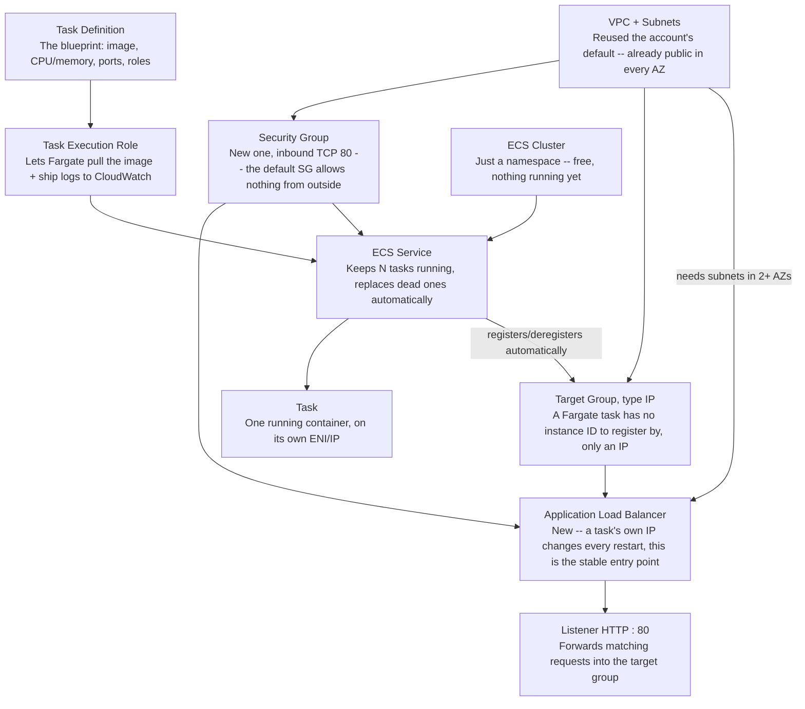
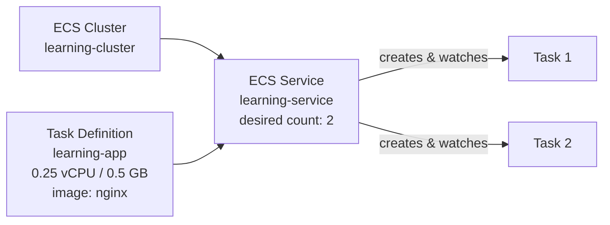
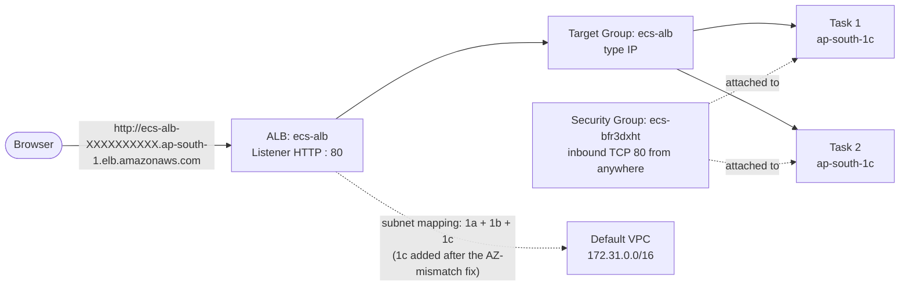
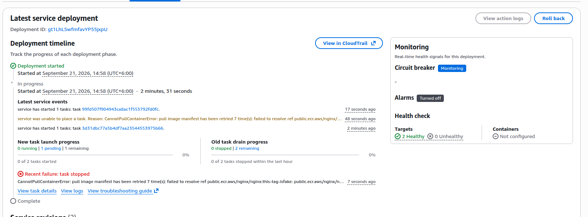
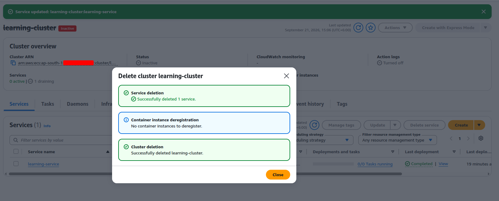

# Container Orchestration: ECS Fargate & EKS

AWS's two container orchestrators, covered at the depth actually
practiced hands-on: ECS Fargate from the console through Terraform, EKS
at the fundamentals level, and how to actually decide between the two.
This is deliberately not a generic Kubernetes chapter — EKS here means
the core control-plane concepts and object model, not a full Kubernetes
deep-dive. For the container-image side (what actually runs on top of
either of these), see
[Docker: Production Container Images](docker-production-images.md).

## ECS Fargate

**Answer:**

- Amazon ECS (Elastic Container Service) is AWS's own container
  orchestrator — it schedules Docker containers onto compute, keeps a
  declared number of them running, replaces one that crashes, and wires
  them up to a load balancer, without needing a self-managed Kubernetes
  control plane (that's EKS's job, covered below).
- Two launch types decide what actually runs the containers:
    - **EC2** — your own Auto Scaling Group of instances; you size,
      patch, and pay for the underlying servers yourself.
    - **Fargate** — serverless; AWS runs the containers on its own
      infrastructure, you declare CPU and memory per task, and there's
      no EC2 instance to manage at all.
- The walkthrough below uses Fargate throughout, which is why an entire
  category of host-level maintenance — AMI patching, instance
  right-sizing — never comes up here the way it would with EC2-based
  compute.

### What Actually Makes ECS Different

**Answer:**

- ECS's core distinction from EKS is that there's no Kubernetes API
  involved at all — no `kubectl`, no YAML manifests, no separate
  cluster-autoscaler/ingress-controller ecosystem to install and keep
  patched.
- It's AWS's own proprietary scheduler, so it only ever runs on AWS —
  but in exchange it gets first-class, no-extra-setup integration with
  the rest of AWS: an IAM role attached directly to a task (the task
  role, below), an ALB target group registered automatically as tasks
  start and stop, logs shipped straight to CloudWatch, and secrets
  pulled from Secrets Manager/Parameter Store at container start — all
  built in, none of it a separate Helm chart or operator to install and
  maintain.

!!! note "The tradeoff for that simplicity"

    - Kubernetes' whole ecosystem — Helm charts, operators, a huge base
      of transferable knowledge and tooling — doesn't carry over to ECS
      at all.
    - Neither does the workload itself: an ECS task definition doesn't
      run on GKE, AKS, or on-prem the way a Kubernetes manifest does.
    - ECS is the simpler, faster-to-learn option specifically *because*
      it gives up that portability.

### When to Actually Reach for It

| Situation | Better fit |
|---|---|
| Already fully committed to AWS, want to run containers without learning or operating a Kubernetes control plane | **ECS** — simplest path, least new machinery |
| Need portability across clouds, or already have Kubernetes expertise/tooling (Helm, existing operators) elsewhere | **EKS** — same containers, a control plane that runs anywhere Kubernetes does |
| Short, bursty, event-driven work — a few seconds to a few minutes, no long-running process | **Lambda** — no cluster, no service to keep alive, billed per invocation |
| A handful of long-running services, steady load, no need for auto scaling or rolling deploys at all | Plain EC2, no orchestrator — fewer moving parts, but every restart/replace/rollout is manual |

### Cost, Compared

**Answer:**

- The orchestrator itself is not where ECS and EKS actually differ in
  price — the compute underneath (EC2 or Fargate) costs the same either
  way.
- The difference is the control plane, laid out below.

| | Control plane cost | Compute cost |
|---|---|---|
| ECS | Free — no charge for the ECS scheduler itself | EC2 launch type (pay for the instances) or Fargate (pay per vCPU/memory-second) |
| EKS | About $0.10/hour per cluster (roughly $73/month), flat, regardless of how small the workload is | Identical EC2 or Fargate pricing underneath |
| Self-managed Kubernetes on plain EC2 | Free (no control-plane fee) | Same EC2 pricing, plus the engineering time to run and patch the control plane yourself |
| Lambda | None — no cluster at all | Per-invocation and per-millisecond; cheapest for infrequent or spiky work, most expensive per unit of *sustained* compute |

!!! danger "Fargate vs. the EC2 launch type isn't a flat 'Fargate always costs more' rule"

    - Fargate charges a real premium per vCPU/memory-second over
      on-demand EC2 pricing for equivalent capacity — but that premium
      buys zero idle capacity, since Fargate only ever runs exactly what
      was requested, nothing more.
    - A handful of small, spiky tasks that would otherwise sit on a
      mostly-idle EC2 instance are often cheaper on Fargate precisely
      because nothing is paid for while idle.
    - Many tasks bin-packed tightly onto a small number of large,
      highly-utilized EC2 instances (or EC2/Fargate Spot capacity for
      either launch type) usually wins the other way.
    - The right call depends on utilization, not on Fargate or EC2 being
      universally cheaper.

### Core Concepts

!!! success "What to actually know before touching any of the bullets below"

    - A **cluster** is just a logical grouping — free, and mostly a
      namespace, not a piece of infrastructure by itself.
    - A **task definition** is the blueprint (image, CPU/memory, ports,
      environment, IAM roles) — the ECS equivalent of a Docker Compose
      file.
    - A **task** is one running instance of that blueprint.
    - A **service** is what actually keeps a declared number of tasks
      running continuously, replacing one that dies and driving a
      rolling deployment — a cluster with no service running in it does
      nothing at all, it's just an empty namespace waiting for one.

- A **task definition revision**: every change to a task definition
  creates a new numbered revision rather than overwriting the old one —
  a running service points at a specific revision, and rolling back is
  just pointing it at the previous one, with the old revision still
  there to inspect.

#### Task Role vs. Execution Role

Two separate IAM roles, answering two separate questions, and mixing
them up is the single most common ECS IAM mistake.

- **Execution role** — what **ECS itself** needs to actually start the
  container: pull the image from ECR, write logs to CloudWatch, and
  fetch any secrets referenced in the task definition's own `secrets`
  field before the container process even starts.
- **Task role** — what the **application code running inside the
  container** is allowed to do once it's up — call S3, read from
  Secrets Manager at runtime, write to DynamoDB. See
  [Role 1 — Application Role (ECS Tasks)](aws-accounts-and-iam.md#the-three-iam-roles-for-assignment-a1)
  for a real example of exactly this role, scoped to only what one
  specific service actually needs.
- Granting the application everything the execution role has (or vice
  versa) defeats the whole point of having two roles — a compromised
  container should only be able to do what the *application* role
  allows, not also re-pull images or write arbitrary log groups.

#### CPU and Memory Sizing

- Fargate tasks pick from a **fixed set of CPU/memory combinations**
  (e.g. 0.25 vCPU pairs with 0.5–2 GB, 1 vCPU pairs with 2–8 GB) —
  not an arbitrary number, unlike sizing an EC2 instance.
- A container that exceeds its **memory** limit gets OOM-killed
  immediately — no warning, no throttling, the container process is
  just terminated and ECS restarts it.
- Exceeding the **CPU** limit doesn't kill anything — the container is
  simply throttled to its allotted share, which shows up as the
  application getting slower under load rather than crashing.

#### `awsvpc` Networking

- Every task gets its **own elastic network interface (ENI)**, with
  its own private IP — not a shared IP with port mapping the way
  classic Docker bridge networking works. Each task looks, from the
  network's perspective, like its own small EC2 instance.
- **The practical limit this creates:** each EC2 instance type only
  supports a fixed number of ENIs, which caps how many `awsvpc` tasks
  can run per instance — a real capacity constraint on the EC2 launch
  type that Fargate (no instances to manage) doesn't have to think
  about at all.

#### ALB Integration and Service Discovery

- A service registers its running tasks' IPs with an ALB **target
  group** automatically as tasks start and stop — the same target
  group mechanism covered in
  [Application Load Balancer Deep Dive](load-balancing-and-dns.md#application-load-balancer-alb-deep-dive),
  just kept in sync by ECS instead of maintained by hand.
- **Service discovery** (via AWS Cloud Map) is the service-to-service
  equivalent — a DNS name that always resolves to currently-healthy
  task IPs, for traffic between internal services that doesn't go
  through a load balancer at all.

#### Service Auto Scaling

- The same **target tracking** idea already covered for
  [Auto Scaling Groups](auto-scaling-groups.md#target-tracking-simplest-most-common),
  applied to a service's **desired task count** instead of an ASG's
  instance count — pick a metric (CPU, memory, request count per
  target) and a target value, and ECS adjusts task count to hold it.

#### Rolling Deployments and the Deployment Circuit Breaker

- A rolling deployment replaces old tasks with new ones gradually,
  governed by **minimum/maximum healthy percent** — e.g. never drop
  below 100% of desired capacity while never exceeding 200%, so
  there's always full capacity available during the rollout.
- The **deployment circuit breaker** watches the new tasks' health
  during a rollout, and automatically rolls back to the previous
  task definition revision if too many new tasks fail to start
  healthy — the same "stop digging once it's clearly not working"
  idea as the
  [circuit breaker pattern](../backend/fault-tolerance-patterns.md#1-circuit-breakers)
  covered elsewhere, applied to deployments instead of API calls.

### Hands-On: A First ECS Service, from the Console

**Answer:**

- Every concept above is worth seeing click by click before it's ever
  expressed as Terraform.
- Nothing in this walkthrough costs more than a few cents, even left
  running for an hour, since Fargate bills per second and there's no
  idle EC2 instance sitting underneath to forget about.

#### Why Each Piece Exists, Before Any Clicking

Each component below solves exactly one problem the one before it
doesn't — worth seeing as a dependency chain before it turns into eight
separate steps.

*A security group rule is meaningless without a VPC for it to live in; a
listener is meaningless without a target group to forward into. Each
layer only becomes useful once the one before it already exists.*

VPC + Subnets — **why the account's default, not a new one**
:   The default VPC already has a public subnet in every Availability
    Zone, each with a route to an Internet Gateway — exactly what an ALB
    and an internet-reachable task both need. Building a VPC by hand
    (CIDR planning, route tables) is its own dedicated exercise; reusing
    what's already there keeps this lab focused on ECS and ALB mechanics
    instead.

Security Group — **why a new one, not the account's `default`**
:   AWS's own default security group only allows traffic between
    resources that already share it — nothing inbound from the
    internet. Nothing here could ever be reached from a browser without
    a security group carrying an explicit inbound rule (TCP 80, from
    anywhere), so a new one was created specifically for this.

Target Group — **why type IP, not Instances**
:   "Instances" registers by EC2 instance ID — something a Fargate task
    simply doesn't have. `awsvpc` networking mode gives every task its
    own network interface and IP address instead, so "IP addresses" is
    the only target type that can represent a Fargate task at all; it
    isn't a preference, it's the only option that works.

Application Load Balancer — **why a brand-new one, and why it needed
two Availability Zones**
:   Before this, the only way to reach a task was its own public IP —
    one that changes on every restart or replacement. An ALB exists
    specifically to give one stable DNS name that always forwards to
    whichever tasks are currently healthy, no matter how many times the
    tasks underneath it have changed. An ALB requires subnets in **at
    least two** Availability Zones by design, for its own cross-AZ
    resilience — which is exactly what produced an "Unused" target
    status during this build: the service placed tasks in a third AZ the
    ALB hadn't been given a subnet for yet, and adding that AZ's subnet
    to the ALB was the actual fix.

#### What Was Actually Built

Split into two smaller diagrams on purpose — the ECS control-plane side,
and the networking side it all sits inside — rather than one dense
diagram trying to show both at once.

**The ECS side — cluster, task definition, service, tasks**

*A cluster and a task definition are independent of each other — neither
needs the other to exist. A service is what actually ties them together,
then keeps exactly two tasks alive from that point on.*

**The networking side — VPC, ALB, target group, security group**

*Everything here lives in the account's default VPC — no new VPC was
built for this lab. The one real bug this diagram hints at: the ALB's
subnet mapping originally covered only two of the three AZs, while the
service happened to place both tasks in the third — the "Unused" target
status, fixed by adding that AZ's subnet to the ALB.*

#### 1. Create a Cluster

**ECS console → Clusters → Create cluster**

- Name it `learning-cluster`.
- Under **Infrastructure**, the console offers three options —
  **Fargate only**, **Fargate and Managed Instances** (AWS still
  provisions and patches the underlying EC2 instances for you, with more
  control over instance type than pure Fargate), and **Fargate and
  Self-managed instances** (the traditional EC2 launch type — you own
  patching, sizing and scaling yourself, via your own Auto Scaling
  Group). Pick **Fargate only**.
- Create it. This takes seconds — a cluster really is just a logical
  namespace, nothing running yet, nothing billed yet.

!!! danger ""Unable to assume the service linked role. Please verify that the ECS service linked role exists.""

    - A real, first-time-only failure: AWS is supposed to auto-create
      the `AWSServiceRoleForECS` service-linked role behind the scenes
      the moment any ECS resource is created in an account, and that
      auto-creation can lag right when `Create cluster` runs, failing
      this one attempt.
    - Check **IAM console → Roles** for `AWSServiceRoleForECS` first —
      it's very often already there despite the error, created as a
      side effect of the same failed attempt.
    - If so, just wait 60–120 seconds (IAM's own eventual-consistency
      delay across regions) and retry **Create cluster** — nothing else
      needs to change.
    - Only if the role genuinely doesn't exist yet, create it explicitly
      from CloudShell or a local terminal:
      `aws iam create-service-linked-role --aws-service-name ecs.amazonaws.com`.
    - The IAM console's own guided **Create role → AWS service → Elastic
      Container Service** flow is a trap here — on the current console
      that flow creates a regular, custom-named role from an old
      managed-policy template (`AmazonEC2ContainerServiceRole`), not the
      actual service-linked role this error is asking for, and won't fix
      anything.

#### 2. Create a Task Definition

**Task definitions → Create new task definition**

- Family name `learning-app`, launch type **Fargate**, task size the
  smallest available — **0.25 vCPU / 0.5 GB**.
- Let the console auto-create the task execution role
  (`ecsTaskExecutionRole`) — this is the execution role from the
  concepts above, the one that lets Fargate pull the image and write
  logs, separate from whatever permissions the *application itself*
  needs (the task role).
- Container details: name `app`, image
  `public.ecr.aws/nginx/nginx:latest` (a public image — no registry
  login needed for this first pass), port mapping `80/TCP`, logging left
  on its default (wires up CloudWatch Logs automatically).

#### 3. Run One Standalone Task — See It Work Before Anything Else

**Clusters → learning-cluster → Tasks tab → Run new task**

- Launch type Fargate, task definition `learning-app`.
- Networking: a **public subnet**, and **Public IP** turned on.
- Security group: **create a new one** here rather than reusing the
  account's **default** security group — the default one only allows
  traffic between resources that already share it, nothing inbound from
  the internet. Choose "Create a new security group," add an inbound
  rule (Type: Custom TCP, Port: `80`, Source: Anywhere / `0.0.0.0/0`),
  and reuse this same security group for the service and load balancer
  in the steps below.
- Run it, and watch the task move `PROVISIONING → PENDING → RUNNING`.
- Once running, find its public IP under the task's Networking tab and
  open `http://<that-ip>` in a browser — the nginx welcome page confirms
  the whole round trip: click Run, a task launches, you can reach it.
- Stop the task once you've seen it (Tasks tab → select → Stop) — a
  standalone task, unlike a service, is never replaced if it dies or is
  stopped.

#### 4. Turn It into a Service — This Is What Actually Keeps It Running

**Services tab → Create**

- Same task definition — leave the **revision** field blank or on
  "latest" rather than typing a number in. Only revision `1` exists at
  this point; revision `2` doesn't show up until step 6 deliberately
  creates it, so entering `2` here now fails with a "task definition not
  found"-style error.
- Service name `learning-service`, desired tasks `2` (so step 6's
  rolling deploy has something to actually roll).
- Same public subnet/security group (the one created in step 3)/
  public-IP settings as step 3. Skip the load balancer for now.
- Once both tasks are running, manually stop one from the Tasks tab and
  watch the service launch a replacement automatically within moments —
  the clearest possible demonstration of what a service actually adds
  over a standalone task.

!!! success "Pausing here without losing anything, or paying for anything, while paused"

    - Fargate only bills per second while a task is actually `RUNNING`
      — the cluster, the task definition, and the service's own
      configuration cost nothing at all while idle.
    - To stop paying without tearing anything down: **learning-service →
      Update service** → set **Desired tasks** to `0` → Update. Both
      running tasks stop, cost drops to zero, and everything else
      (service name, task definition link, networking, security group)
      stays exactly as configured.
    - Coming back later just means the same screen, **Desired tasks**
      back to `2`, and picking up at whichever step was next.

#### 5. Put It Behind an Application Load Balancer

**Answer:**

- Two task public IPs that change on every restart isn't how anyone
  actually reaches an ECS app — one stable DNS name that always points
  at whichever tasks are currently healthy is what an ALB actually buys
  here.
- The full console walkthrough for wiring up an ALB and target group in
  front of an ECS Fargate service is the same load-balancing topic
  covered in more depth in
  [Load Balancing & DNS](load-balancing-and-dns.md), with one
  difference worth calling out here: the target group must be **type
  IP** instead of instances (per the concepts above), and tasks
  register with it automatically instead of via a manual
  `register-targets` call.
- Practical names to use: `learning-tg` / `learning-alb`, the security
  group from step 3, and `learning-service` / container `app` : port
  `80` as the service to attach it to. Both tasks should show healthy in
  the target group before moving on to step 6.

#### 6. Deploy a New Revision — Watch a Rolling Update Happen

- **Task definitions → learning-app → Create new revision** — change
  something small (swap the image tag, or add an environment variable).
- **Services → learning-service → Update service** — select the new
  revision.
- Watch the Deployments tab: new tasks start on the new revision, wait
  to pass the health check, and *only then* are the old tasks stopped —
  the same launch-healthy-then-drain sequence a load balancer's rolling
  deployment always follows, seen here directly instead of described.

#### 7. Break It on Purpose

**Answer:**

Reproducing each of these deliberately, one failure at a time, means the
error message is already familiar before it shows up for real:

- Point a new revision at an image that doesn't exist
  (`nginx:this-tag-is-fake`) → update the service → tasks stuck in a
  pull-and-restart loop.
- Move the service to a **private** subnet with no NAT gateway → tasks
  can't reach the registry at all → same restart-loop symptom, a
  completely different cause.
- Remove the security group's inbound rule on port 80 → the task itself
  runs fine, but the health check fails anyway → target group shows
  "unhealthy," the ALB starts returning 503.

The first of those, actually happening in the console: a task
definition revision (`learning-app:3`) pointed at a deliberately broken
image tag kept retrying with `CannotPullContainerError`, while "Old task
drain progress" stayed at 0 stopped — the previous revision's two tasks
were left untouched and still showing 2 Healthy in the target group.
Zero downtime, precisely because ECS never drains an old task until a
new one has actually replaced it.

{ target="_blank" rel="noopener" }

*`learning-app:3` can't pull its (deliberately broken) image and keeps
retrying, while "Old task drain progress" stays at 0 stopped — the two
`learning-app:2` tasks are untouched and still showing 2 Healthy in the
target group.*

!!! success "The circuit breaker is what ends this, one way or another"

    - Left alone, this deployment doesn't hang forever — the deployment
      circuit breaker eventually detects the repeated failure and fails
      the deployment automatically, rolling the service back to the last
      working revision without anyone clicking anything.
    - The **Roll back** button does the identical thing immediately, on
      demand, instead of waiting — the manual equivalent of what the
      circuit breaker does on its own.

#### 8. Clean Up

Order matters for the load balancer pieces, since they live in EC2, not
ECS, and nothing below touches them automatically:

- **Delete the ALB and its target group first** (EC2 console → Load
  Balancers, then Target Groups) — entirely separate resources from
  anything ECS's own cluster deletion handles next.
- **Clusters → learning-cluster → Delete cluster.** The console's
  delete flow cascades through everything ECS-owned in one confirmation
  — no need to separately set desired count to 0 or delete the service
  first. It runs service deletion, container instance deregistration (a
  no-op under Fargate, since there are no EC2 instances to deregister),
  and cluster deletion as three tracked steps in one dialog.

{ target="_blank" rel="noopener" }

*One "Delete cluster" click, three cascaded steps confirmed — service
deletion, container instance deregistration (nothing to do on Fargate),
and the cluster itself, gone in a single dialog.*

- Task definition revisions cost nothing to leave behind — this step is
  pure tidiness, not a cost saver. Deleting one is a two-step process,
  since a revision can't be deleted while it's **Active**:
    1. **Task definitions → learning-app**, select the revision(s) via
       checkbox, **Actions → Deregister**. This flips it to **Inactive**
       and hides it from the default (Active-only) filtered view — which
       is usually why it looks like there's nothing to act on.
    2. Switch the status filter to show **Inactive** revisions, select
       it again, **Actions → Delete** — the actual permanent delete,
       only available once a revision is Inactive.
    3. To remove every revision under the family at once instead of one
       at a time, **Delete task definition family** is available at the
       family level (`learning-app` itself) — deregisters and deletes
       everything under it in a single action.

!!! success "What this earns before ever touching Terraform"

    A reusable ECS service module stops being an abstract block of HCL
    once every field in it — cluster, task definition, service, target
    group — has already been clicked through by hand and watched
    actually do something. The CLI and Terraform versions of this exact
    walkthrough are the natural next steps once the console version
    feels familiar.

### This Same Lab, as Terraform

The same walkthrough above, written as two separate Terraform states
rather than clicked through by hand, split so neither one needs the
other's IAM permissions:

- **`ecs-cluster-service`** — cluster, security group, task execution
  role, CloudWatch log group, task definition, and service.
- **`ecs-alb`** — target group (type IP), ALB, and listener.

The source for both lives in this author's public
[`DevOps-Roadmap`](https://github.com/Fahad-Md-Kamal/DevOps-Roadmap/tree/main/IaC)
repository, under `IaC/ecs-cluster-service/` and `IaC/ecs-alb/`.

**Answer — apply order, and why it matters:**

1. Apply `ecs-cluster-service` first, with its `target_group_arn`
   variable left at the default `null` — the service comes up with no
   load balancer, exactly step 4 above before step 5 exists.
2. Feed its `security_group_id` output into `ecs-alb` and apply that.
3. Feed `ecs-alb`'s `target_group_arn` output back into
   `ecs-cluster-service` and apply once more — this activates a
   `dynamic "load_balancer"` block and attaches the ALB, the Terraform
   equivalent of step 5's "Update service" click.

The full reasoning lives in each folder's own `main.tf` comments, not
repeated here.

!!! success "New revisions and teardown are both one-line answers"

    - A new task definition revision is just changing
      `container_image` (or `cpu`/`memory`/`container_port`) in
      `ecs-cluster-service` and running `terraform apply` again — no
      console click needed for step 6 at all.
    - Deleting everything is `terraform destroy` in `ecs-cluster-service`
      first, then in `ecs-alb` — the reverse of step 8's console order,
      since here two separate Terraform states are doing the ordering
      instead of one cascaded "Delete cluster" button that already knows
      about both.

## EKS Fundamentals

The Kubernetes side of the ECS-vs-EKS decision below — the core
control-plane concepts and object model actually practiced here, not a
full Kubernetes deep-dive. Knowing that `kubectl apply` is "the command
that deploys things" is the tool-usage version of this; the two
mechanisms below are what's actually happening underneath it, and
they're what let you reason about a cluster when `kubectl` itself isn't
telling you enough.

### What `kubectl apply` Actually Does

Nothing in Kubernetes runs commands *at* the cluster the way `aws ec2
run-instances` does. The entire model is **declarative** and built on
one continuous loop, repeated by every controller, forever:

1. **Observe** the actual state of the cluster right now.
2. **Compare** it to the desired state sitting in **etcd** (the
   cluster's single source of truth).
3. **Act** to close whatever gap exists.
4. Go back to step 1, immediately.

`kubectl apply` doesn't deploy anything itself — it just writes *desired
state* into etcd via the API server (the only thing anything in the
cluster is allowed to talk to directly). A **controller** — a
small program running this exact loop for one specific resource type —
notices the new desired state shortly after and does the actual work.

!!! success "This is why a killed Pod comes back on its own"

    There's no special "restart crashed pods" feature. A Deployment's
    controller is running the loop above, continuously: desired replica
    count is 3, it observes 2 actual Pods, so it creates a third. That's
    the entire mechanism — the same generic loop handles a crashed Pod,
    a manually deleted Pod, and a node disappearing out from under one,
    because to the controller they're all just "actual state no longer
    matches desired state."

### How a Service Actually Reaches a Pod

A Kubernetes **Service** is not a running process and not a load
balancer sitting somewhere in the cluster — it's a stable virtual IP
(the **ClusterIP**) that exists only as **rules programmed into every
node's kernel**, via `iptables` (or IPVS) by a component called
**kube-proxy**.

- **kube-proxy** watches the API server for Service/Endpoint changes and
  continuously rewrites each node's NAT rules: "traffic sent to
  `ClusterIP:port` → rewrite the destination to one of these actual Pod
  IPs." This rewrite — **DNAT**, destination network address
  translation — happens in the kernel, before the packet ever reaches
  an application.
- [CoreDNS](load-balancing-and-dns.md#how-dns-resolution-actually-works)
  resolves a Service's name (`my-service.default.svc.cluster.local`) to
  its ClusterIP — the exact same recursive-lookup idea already covered
  for the public internet, just serving cluster-internal names instead
  of public ones.
- Reaching a Pod through a Service is therefore **two separate
  rewrites**: a DNS name becomes a ClusterIP (CoreDNS), then the
  ClusterIP becomes a real Pod IP (kube-proxy's DNAT rule) — and nothing
  above either of those two layers ever needs to know a Pod's actual IP
  at all.

<svg viewBox="0 0 900 460" xmlns="http://www.w3.org/2000/svg" role="img" aria-label="Animated diagram of a Service's stable ClusterIP being DNAT-rewritten to a Pod IP, then silently repointed to a replacement Pod" style="width:100%;height:auto;max-width:900px;display:block;margin:0 auto;font-family:inherit;">
<rect x="0" y="0" width="900" height="460" fill="#ffffff" stroke="#d0d5dd" stroke-width="1"></rect>
<defs><marker id="k8s-arrow" viewBox="0 0 10 10" refX="8" refY="5" markerWidth="6" markerHeight="6" orient="auto-start-reverse"><path d="M0 0L10 5L0 10z" fill="#9aa5b3"></path></marker></defs>
<rect x="16" y="170" width="150" height="90" rx="8" fill="#eef1f5" stroke="#434d5c" stroke-width="2"></rect>
<text x="91" y="210" font-size="15" font-weight="600" text-anchor="middle" fill="#2b313b">Client Pod</text>
<text x="91" y="230" font-size="12" text-anchor="middle" fill="#5b6472">sends to ClusterIP</text>
<rect x="226" y="170" width="190" height="90" rx="8" fill="#eaf2fb" stroke="#2f6fb3" stroke-width="2"></rect>
<text x="321" y="200" font-size="14" font-weight="600" text-anchor="middle" fill="#1d4a78">Service ClusterIP</text>
<text x="321" y="220" font-size="13" text-anchor="middle" fill="#3d699a">10.96.0.42</text>
<text x="321" y="238" font-size="11" text-anchor="middle" fill="#5b82ab">(never changes)</text>
<rect x="476" y="170" width="190" height="90" rx="8" fill="#fdf3e3" stroke="#b5831f" stroke-width="2"></rect>
<text x="571" y="198" font-size="13" font-weight="600" text-anchor="middle" fill="#7a5c14">kube-proxy</text>
<text x="571" y="215" font-size="12" font-weight="600" text-anchor="middle" fill="#7a5c14">iptables DNAT rule</text>
<text x="571" y="233" font-size="12" text-anchor="middle" fill="#9a7420"><animate attributeName="opacity" values="1;1;0;0;1;1" keyTimes="0;0.47;0.5;0.53;0.56;1" dur="12s" repeatCount="indefinite"></animate>→ Pod A (10.244.1.5)</text>
<text x="571" y="233" font-size="12" text-anchor="middle" fill="#9a7420"><animate attributeName="opacity" values="0;0;0;1;1;0" keyTimes="0;0.5;0.53;0.56;0.95;1" dur="12s" repeatCount="indefinite"></animate>→ Pod D (10.244.1.9)</text>
<rect x="716" y="110" width="160" height="80" rx="8" fill="#e8f7f0" stroke="#1f9d6b" stroke-width="2"><animate attributeName="opacity" values="1;1;0;0" keyTimes="0;0.46;0.5;1" dur="12s" repeatCount="indefinite"></animate></rect>
<text x="796" y="145" font-size="14" font-weight="600" text-anchor="middle" fill="#0f6b45"><animate attributeName="opacity" values="1;1;0;0" keyTimes="0;0.46;0.5;1" dur="12s" repeatCount="indefinite"></animate>Pod A</text>
<text x="796" y="164" font-size="12" text-anchor="middle" fill="#3d9a73"><animate attributeName="opacity" values="1;1;0;0" keyTimes="0;0.46;0.5;1" dur="12s" repeatCount="indefinite"></animate>10.244.1.5</text>
<text x="796" y="178" font-size="18" text-anchor="middle" fill="#c0392b"><animate attributeName="opacity" values="0;0;1;1;0;0" keyTimes="0;0.43;0.46;0.5;0.52;1" dur="12s" repeatCount="indefinite"></animate>killed ✕</text>
<rect x="716" y="250" width="160" height="80" rx="8" fill="#e8f7f0" stroke="#1f9d6b" stroke-width="2"><animate attributeName="opacity" values="0;0;1;1" keyTimes="0;0.52;0.56;1" dur="12s" repeatCount="indefinite"></animate></rect>
<text x="796" y="285" font-size="14" font-weight="600" text-anchor="middle" fill="#0f6b45"><animate attributeName="opacity" values="0;0;1;1" keyTimes="0;0.52;0.56;1" dur="12s" repeatCount="indefinite"></animate>Pod D (new)</text>
<text x="796" y="304" font-size="12" text-anchor="middle" fill="#3d9a73"><animate attributeName="opacity" values="0;0;1;1" keyTimes="0;0.52;0.56;1" dur="12s" repeatCount="indefinite"></animate>10.244.1.9</text>
<circle r="9" fill="#d9822b" cy="215"><animate attributeName="cx" values="91;321;571;796;796;571;321;91;91;321;571;796;796" keyTimes="0;0.06;0.12;0.18;0.40;0.46;0.5;0.56;0.60;0.66;0.72;0.78;1" dur="12s" repeatCount="indefinite"></animate><animate attributeName="cy" values="215;215;215;150;150;215;215;215;215;215;215;290;290" keyTimes="0;0.06;0.12;0.18;0.40;0.46;0.5;0.56;0.60;0.66;0.72;0.78;1" dur="12s" repeatCount="indefinite"></animate></circle>
<text x="450" y="400" font-size="19" text-anchor="middle" fill="#1f2a3a"><animate attributeName="opacity" values="1;1;0;0" keyTimes="0;0.44;0.48;1" dur="12s" repeatCount="indefinite"></animate>The client only ever talks to the ClusterIP. kube-proxy's rule DNATs it to Pod A.</text>
<text x="450" y="400" font-size="19" text-anchor="middle" fill="#1f2a3a"><animate attributeName="opacity" values="0;0;1;1;0;0" keyTimes="0;0.5;0.54;0.9;0.95;1" dur="12s" repeatCount="indefinite"></animate>Pod A is killed and replaced by Pod D. The ClusterIP never moves — kube-proxy just repoints the rule.</text>
</svg>

!!! danger "A Service's IP being stable doesn't mean a connection is"

    Every new connection can land on a *different* backing Pod — DNAT
    picks a target per connection, not once per client. An application
    that assumes "I'm still talking to the same Pod as my last request"
    without anything actually guaranteeing that (no session affinity
    configured) will see requests land on different Pods, with
    independent memory/state, from one request to the next.

### Practical EKS Concepts

The mechanisms above explain *how* Kubernetes works; these are the
concrete decisions actually made running a real EKS cluster.

#### Managed Node Groups vs. Fargate Profiles

- **Managed node groups** — real EC2 instances, still yours to size and
  patch, but EKS automates their lifecycle (rolling updates, draining
  before termination). You're choosing instance types and capacity,
  same judgment as
  [EC2 Instance Families](ec2-instance-types-and-purchasing-options.md).
- **Fargate profiles** — no nodes at all; each Pod matching the
  profile's selector runs on its own serverless compute, the same
  no-instances-to-manage trade-off
  [ECS Fargate](#ecs-fargate) already makes, just for Kubernetes Pods
  instead of ECS tasks.
- Mixing both in one cluster is common: steady, predictable workloads
  on managed node groups (cheaper at sustained load), bursty or
  infrequent workloads on Fargate profiles (no idle capacity to pay
  for).

#### ConfigMaps & Secrets

- A **ConfigMap** holds non-sensitive configuration (a URL, a feature
  flag) that a Pod reads as environment variables or a mounted file —
  the Kubernetes-native way to avoid baking config into the container
  image.
- A **Secret** looks identical in use, but holds sensitive data
  instead.

!!! danger "A Kubernetes Secret is base64, not encrypted"

    Base64 is an *encoding*, not encryption — anyone with read access
    to the Secret object (or etcd itself, if it isn't encrypted at
    rest) can trivially decode it back to plaintext. Enabling
    **encryption at rest for Secrets** (via a KMS key, the same
    [envelope encryption](kms-secrets-and-cognito.md#envelope-encryption-why-kms-doesnt-encrypt-your-data-directly)
    already covered for S3) is what actually protects a Secret sitting
    in etcd — the base64 encoding by itself protects against nothing.

#### Requests & Limits

- A **request** is what a Pod is guaranteed, and what the scheduler
  uses to decide which node has room for it — a Pod requesting 500m
  CPU only gets scheduled onto a node with at least that much
  available.
- A **limit** is the hard ceiling — exceeding the memory limit gets the
  Pod OOM-killed, exactly the same consequence already covered for
  [ECS's memory sizing](#cpu-and-memory-sizing) above, just enforced by
  the kubelet instead of the ECS agent. Exceeding the CPU limit throttles
  instead of killing, same as ECS too — this is the same underlying
  cgroups mechanism covered in
  [What a Container Actually Is](docker-production-images.md#cgroups-how-much-the-process-is-allowed-to-use),
  Kubernetes is just the layer setting those cgroup values on your behalf.

#### IRSA: IAM Roles for Service Accounts

- Without IRSA, every Pod on a node shares that **node's own** IAM
  role — far too broad, since every workload on the node can do
  whatever the node's role allows, whether or not that specific Pod
  needs it.
- IRSA gives a **Pod its own, narrowly-scoped IAM role** instead —
  mechanically, the same federated-identity pattern already covered
  for
  [Cognito Identity Pools](kms-secrets-and-cognito.md#cognito-identity-for-your-applications-own-users):
  a trusted token (here, a Kubernetes service account token, verified
  via the cluster's OIDC provider) gets exchanged for temporary AWS
  credentials through STS, scoped to exactly the role that service
  account is allowed to assume.

#### Horizontal Pod Autoscaler (HPA)

- The same target-tracking idea as
  [ECS's service auto scaling](#service-auto-scaling) and
  [ASG target tracking](auto-scaling-groups.md#target-tracking-simplest-most-common)
  — pick a metric (CPU, memory, or a custom metric) and a target value,
  and the HPA adjusts **replica count** to hold it, at the Pod level
  instead of the instance or task level.

#### AWS Load Balancer Controller

- A Kubernetes `Service` of type `LoadBalancer`, or an `Ingress`
  object, doesn't provision any AWS infrastructure by itself — the AWS
  Load Balancer Controller is what watches for those objects and
  actually creates the real ALB or NLB behind them, keeping its target
  group in sync with Pod IPs as they come and go, the Kubernetes-native
  equivalent of
  [ECS's own target group integration](#alb-integration-and-service-discovery)
  above.

## ECS vs. EKS: The Decision

**Answer:**

- The actual synthesis exercise for this material is deploying the same
  service to EKS behind an ALB ingress, performing a rolling update
  there, and then running a troubleshooting clinic across both runtimes
  — the same class of failure, on both ECS and EKS, to see how each one
  surfaces and is fixed.
- The categories of failure worth being able to diagnose on either
  platform:
    - Image pull failure
    - Wrong subnet
    - Missing permission
    - Failing probe
    - Out-of-memory kill
- Writing out the ECS-vs-EKS comparison explicitly — not just holding it
  as intuition — is the actual deliverable; the "When to Actually Reach
  for It" and "Cost, Compared" tables above are the starting frame for
  that comparison, sharpened by having broken and fixed the same failure
  on both platforms first.
