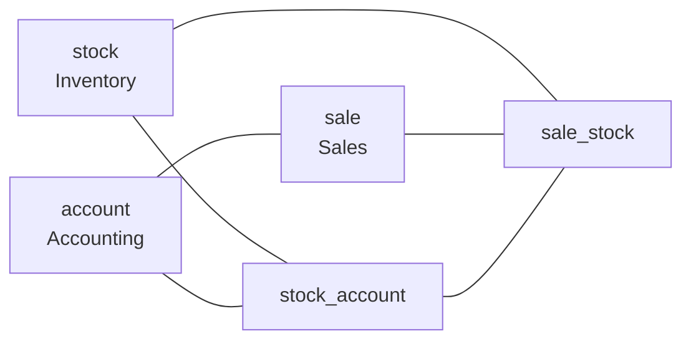

# Odoo Core Flow: Sales to Cash

"Sales to cash" is the main business path in Odoo: a customer gets a
quotation, confirms it, receives goods, gets an invoice, and pays. Three
apps own the three middle steps — **Sales** (`sale`), **Inventory**
(`stock`), and **Accounting** (`account`). They stay separate on
purpose. The glue between them is small, and it is the same glue you use
in your own modules: **hook methods** and `_inherit`.

!!! note "Version"
    Written for **Odoo 20**, from the source on the `20.0` branch of the
    official repository. Method names are real. Line numbers change, so
    search for the name.

## 1. "How do the three apps depend on each other?"



**Answer:**

- `sale` does **not** depend on `stock`. It depends on `sales_team` and
  `account_payment`, which pull in `account`, `payment`, and `portal`.
- `stock` does **not** depend on `sale` or `account`. It depends on
  `product`, `barcodes_gs1_nomenclature`, and `digest`.
- The link is a small **bridge module**, `sale_stock`. It depends on
  `sale` and `stock_account`, and `stock_account` is itself a bridge
  between `stock` and `account`.
- Why this matters:
    - You can install Sales without Inventory. It is a normal setup.
    - Install Inventory later and `sale_stock` installs automatically,
      adding delivery to every order.
- This is the standard Odoo pattern. **A bridge module extends two apps
  without either knowing about the other.**

## 2. "What happens when you click Confirm on a quotation?"

```python
# addons/sale/models/sale_order.py  (simplified)
def action_confirm(self):
    for order in self:
        error_msg = order._confirmation_error_message()
        if error_msg:
            raise UserError(error_msg)
    self.write(self._prepare_confirmation_values())   # state='sale'
    self._action_confirm()                            # empty hook
    self.filtered(lambda so: so._should_be_locked()).action_lock()
    return True
```

**Answer:**

- `sale.order` has four states: `draft` (Quotation), `sent` (Quotation
  Sent), `sale` (Sales Order), and `cancel`.
- `action_confirm` does three things:
    1. Checks the state is `draft` or `sent`.
    2. Writes `state = 'sale'` and the confirmation date.
    3. Calls `_action_confirm()`.
- In the `sale` module, `_action_confirm()` is an **empty method**. Its
  only job is to be overridden by other modules.
- This is a **hook method**: the owner app promises "I will call this
  method at this moment," and bridge modules fill it in.

## 3. "How does confirming a sale create a delivery?"

```python
# addons/sale_stock/models/sale_order.py
def _action_confirm(self):
    self._update_delivery_partner_company()
    self.order_line._action_launch_stock_rule()
    return super()._action_confirm()
```

**Answer:**

- `sale_stock` overrides the empty hook and calls
  `order_line._action_launch_stock_rule()`.
- For each order line, that method:
    - Skips lines that are not in state `sale`, on a locked order, or
      for a product whose type is not Goods (`consu`). Services never
      need a delivery.
    - Works out the quantity **not yet requested** (ordered minus what
      was already launched). Confirming an order a second time, after
      raising a quantity, only requests the difference.
    - Builds a **procurement**: "I need this product, this quantity, at
      this location, by this date."
    - Hands all procurements to `stock.rule.run(...)`.
- From here the Sales app is finished. Everything after this line
  belongs to Inventory. See
  [Odoo Inventory Internals](odoo-inventory-internals.md).

## 4. "How does an order become an invoice?"

**Answer:**

- Invoicing is **pull, not push**. Nothing creates an invoice at
  confirmation. A user (or a scheduled job) calls
  `sale.order._create_invoices(final, grouped)`.
- Each order line has a quantity **to invoice**. It depends on the
  product's invoice policy:
    - Policy "ordered": invoice what was ordered.
    - Policy "delivery": invoice what was **delivered**.
- Under the "delivery" policy, the delivered quantity comes from
  Inventory. `sale_stock` adds a `stock_move` method for
  `qty_delivered`, so done stock moves feed the invoice quantity.
- `_create_invoices` then:
    1. Checks the user can create `account.move` records (otherwise it
       returns nothing).
    2. For each order, builds invoice values (`_prepare_invoice`) and
       one invoice line per invoiceable order line, using
       `Command.create`.
    3. Groups orders into shared invoices by customer, shipping address,
       and currency, unless `grouped=True`.
    4. Raises an error if nothing is invoiceable.
    5. Creates the `account.move` records.
- The result is a **draft** invoice. Posting it is an Accounting step.
  See [Odoo Accounting Internals](odoo-accounting-internals.md).

## 5. "Can you trace one order from start to finish?"

**Answer:**

| Step | Who | Method | Result |
|---|---|---|---|
| 1. Confirm | `sale` | `action_confirm` | Order state `sale` |
| 2. Hook | `sale_stock` | `_action_confirm` | Stock rules launched |
| 3. Procure | `stock` | `stock.rule.run` | A rule is found for each line |
| 4. Move | `stock` | `_run_pull` | `stock.move` created and confirmed |
| 5. Reserve | `stock` | `_action_assign` | Stock reserved, move `assigned` |
| 6. Deliver | `stock` | `_action_done` | Quantity moves, order line delivered |
| 7. Invoice | `sale` | `_create_invoices` | Draft `account.move` |
| 8. Post | `account` | `action_post` | Numbered, balanced journal entry |

- Read the table top to bottom and you have the full path.
- To debug "why was nothing delivered?", walk the steps in order. The
  failing step is usually 3 ("No rule has been found to replenish...").

## 6. "What can you learn from this for your own modules?"

**Answer:**

- **Leave hooks.** If your module has a "something just happened" moment
  that others might extend, call an empty `_action_something()`.
- **Use a bridge module** when two apps should work together but stay
  independent.
- **Extend, don't edit.** `sale_stock` changes what `sale` does without
  touching a line of it.
- **Read the source.** Odoo's best documentation of its own flow is
  `action_confirm` and its overrides. Use "find all overrides of this
  method" in your editor.
- When you customize this flow, override the **hook** (for example
  `_action_confirm`) and call `super()`. Do not copy `action_confirm`.

## 7. "How do AI tools help with a big codebase like this?"

**Answer:**

- Good for: "list every override of `_action_confirm` in the installed
  modules" and "summarize what this method does."
- Risky for: describing the flow from memory. Models mix up Odoo
  versions, and in Odoo 20 several names differ from older versions.
- Ask the tool to quote the method from the source you have, then read
  it yourself.
- See [Interviewing in the AI Era](../../../interview-prep/interviewing-in-the-ai-era.md).

## 8. Interview Questions You're Likely to Get Asked

**Architecture**

- "Why does `sale` not depend on `stock`?" — expects the bridge-module
  pattern (`sale_stock`), [§1](#1-how-do-the-three-apps-depend-on-each-other).
- "How would you make your module react to an order being confirmed?" —
  expects override `_action_confirm` and call `super()`,
  [§2](#2-what-happens-when-you-click-confirm-on-a-quotation).

**Flow**

- "What creates the delivery when an order is confirmed?" — expects
  `_action_launch_stock_rule` through the `_action_confirm` hook,
  [§3](#3-how-does-confirming-a-sale-create-a-delivery).
- "When is an invoice created?" — expects on demand, based on invoice
  policy, [§4](#4-how-does-an-order-become-an-invoice).
- "A confirmed order has no delivery. Where do you look?" — expects
  product type, routes, and the "no rule found" error,
  [§5](#5-can-you-trace-one-order-from-start-to-finish).

---

## Code Samples

No dedicated code samples for this page — it is a guided reading of
real Odoo source. Files to open in the `20.0` branch of the Odoo
repository:

- `addons/sale/models/sale_order.py` — `action_confirm`, `_create_invoices`
- `addons/sale_stock/models/sale_order.py` — the `_action_confirm` override
- `addons/sale_stock/models/sale_order_line.py` — `_action_launch_stock_rule`
